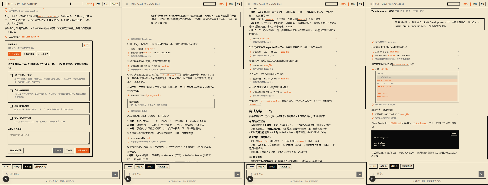
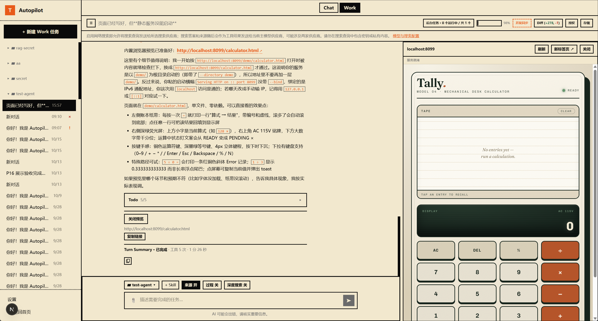
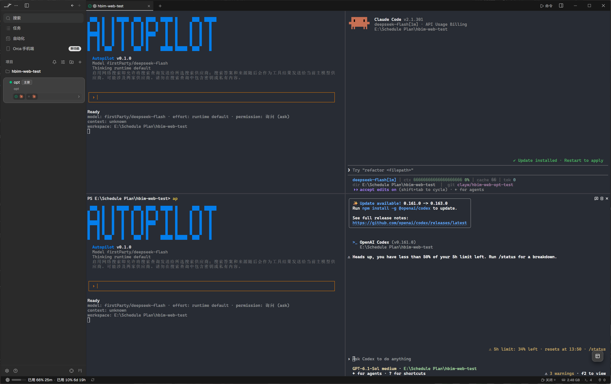

<p align="center">
  
</p>

<p align="center">
  <strong>Autopilot Agent</strong><br>
  本地 AI 编程助手：阅读与修改项目、执行开发命令、跟踪后台任务、管理会话。<br>
  CLI 和本地 Web 共享 TypeScript Agent Runtime。
</p>

<p align="center">
  <a href="https://www.npmjs.com/package/autopilot-agent"></a>
  <a href="https://nodejs.org/"></a>
  <a href="LICENSE"></a>
</p>

<p align="center">作者：ClayW</p>

## 你需要先知道的关键信息

Autopilot 仍有已知限制，实际能力受操作系统、运行环境和工具链影响：

- Windows 不启用 OS 进程沙箱：`run_command`、后台 Job 等进程工具逐次审批后以当前用户权限直接执行，审批只代表你接受该执行方式，不代表已隔离。macOS 继续使用 Seatbelt 沙箱，沙箱不可用时受隔离保护的命令照旧拒绝执行。
- 后台 Job 的停止依赖平台进程树与运行时支持。遇到进程脱离跟踪、平台接口不支持或环境权限不足时，停止结果可能失败，进程树也未必能被精确、完整地终止；不要仅凭根进程退出判断整棵进程树已停止。
- Windows 宿主执行与后台 Job 的进程树生命周期仍有未闭合的真实环境验收；macOS 沙箱实机验证目前暂缓。因此，自动化测试或单一环境的成功不能代表所有系统均已验证。
- Windows 下 `npm`/`npx`/`pnpm` 经受信 `node.exe` + CLI 脚本解析启动，不执行 `.cmd` shim，也不经 shell 拼接；受信 CLI 缺失时命令拒绝执行。

当前版本不提供 `/plan` 和 `/goal` 模式。`/plan` 属于较早期 Agent 工作流设计：先规划、再执行，用来降低当时模型能力有限时的执行风险。现阶段可直接使用默认 Edit/Agent 模式，并明确要求“只分析和规划，不修改任何文件”，获得同等的规划效果。`/goal` 模式当前也未实现。

[访问 npm 包页面](https://www.npmjs.com/package/autopilot-agent)

## 安装 CLI

需要 Node.js `>=20.11.0 <22`，建议 Node 20.20.2 与 npm 10。

```bash
npm install -g autopilot-agent@0.1.0
ap --help
```

主包自动带入 Core、Adapters、Presentation 和 CLI。ap 与 autopilot 等价。完整安装、模型配置、使用和排错见 [主包使用手册](packages/autopilot-agent/README.md)。npm CLI 不包含 Web 应用。

## 从源码运行

```bash
git clone https://github.com/C-Clay-W/autopilot.git
cd autopilot
npm ci
npm run build -w packages/core
npm run build -w packages/adapters
npm run build -w packages/presentation
npm run build -w apps/cli
node apps/cli/dist/main.js --help
```

共享包构建后，Web 使用 `npm run dev -w apps/web -- --hostname 127.0.0.1`。用户配置、工作区和日常开发见 [源码使用指南](agent/doc/HowToUse.md)；构建与测试见 [BUILD.md](BUILD.md)。

## 项目组成

| 包 / 目录 | 职责 |
|---|---|
| [autopilot-agent](packages/autopilot-agent/README.md) | 用户安装入口，关联安装其余四包 |
| [@autopilot-agent/cli](apps/cli/README.md) | 命令解析、Controller、Ink TUI 与文本/JSONL 输出 |
| [@autopilot-agent/core](packages/core/README.md) | Runtime、审批、会话、工具、RAG 与宿主接口 |
| [@autopilot-agent/adapters](packages/adapters/README.md) | Node 存储、工作区、配置、沙箱及外部能力 |
| [@autopilot-agent/presentation](packages/presentation/README.md) | 共享安全事件投影、时间线、分组和展示文案 |
| [apps/web](apps/web/README.md) | Next.js 本地 Chat / Work 界面，源码运行，不作为 npm 应用分发 |

当前源码版本为 **0.2.0**，五个 npm 包此前已发布版本仍为 **0.1.0**；本次 GitHub 源码更新不发布 npm。Windows 宿主执行等变化以源码版本为准，不能从 npm 0.1.0 安装命令推断已获得这些变化。详见 [更新日志](CHANGELOG.md)。

Web Work 新增内置预览面板及 `open_preview`：模型只准备导航，不读取或验证网页；Chat/CLI 不提供此工具。预览与后台 Job 绑定由宿主核验，仍需完整浏览器与 Provider 实机验收。

## 文档

- [CLI 命令参考](agent/doc/CLI-Reference.md)
- [Core API 参考](agent/doc/Core-API.md)
- [源码启动与使用](agent/doc/HowToUse.md)

必要测试、配置及合成 fixture 随源码提供。真实 env、凭据、会话/数据库和内部运行记录不公开。

## 界面截图

<p align="center">
  <br>
  <em>Autopilot Web 对话与任务操作</em>
</p>

<p align="center">
  <br>
  <em>Autopilot Web 工作区</em>
</p>

<p align="center">
  <br>
  <em>Autopilot CLI TUI</em>
</p>

## 安全与贡献

Trust、工具审批和 OS 沙箱各有职责，full_access 仍受路径、Schema 和破坏性命令门禁约束。保留重要项目备份，审查模型改动，不把本地 Web 直接暴露到公网。

欢迎 Issue 和 PR，描述复现、环境及相关验证，避免提交密钥和原始会话。公开分支由开发主线筛选同步，贡献经审查纳入开发主线后再同步。当前为早期版本，平台和沙箱限制见主包手册。

## 许可证

项目代码使用 [MIT](LICENSE)，第三方材料保留独立授权，见 [THIRD_PARTY_NOTICES.md](THIRD_PARTY_NOTICES.md)。
